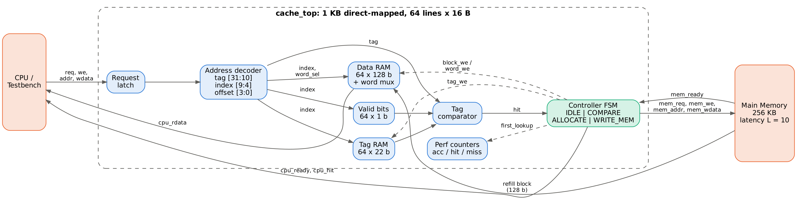
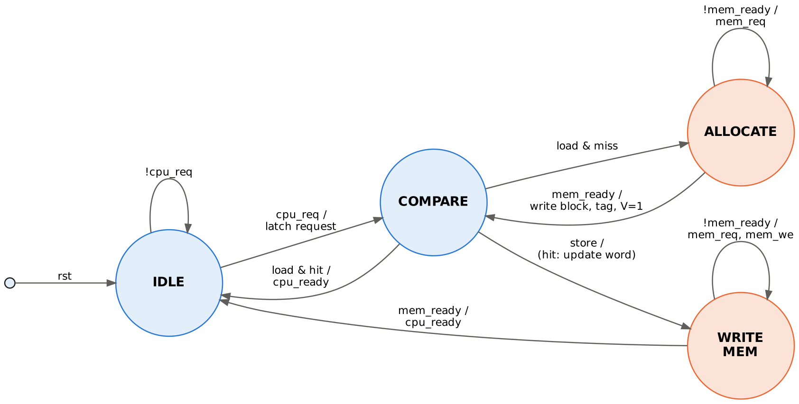
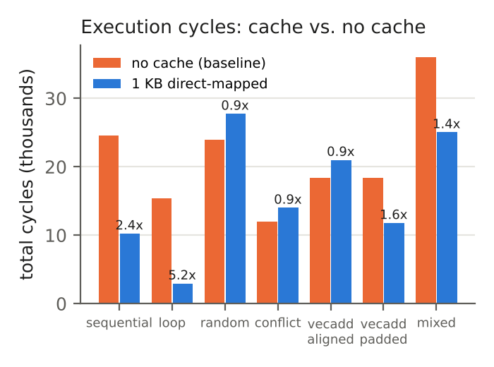
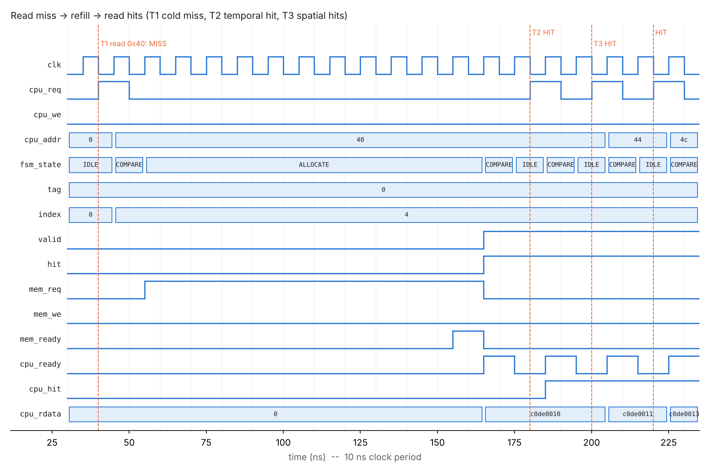

# Project 6: Direct-Mapped Cache Controller (Verilog)

**Modern Computer Architecture, B.Tech CS & AI (Section B). Phase I submission.**
**Team: Short Circuit**, Newton School of Technology, Rishihood University

This repository contains a synthesizable direct-mapped cache controller in Verilog-2005. The cache is 1 KB with 64 lines of 16-byte blocks and uses 32-bit addresses. Its write policy is read-allocate, write-through, no-write-allocate.

The design is verified two ways:

- a self-checking **directed testbench**;
- a **trace-driven testbench**, cross-checked access by access against a Python reference model.

The repository also includes hit-rate / AMAT / speed-up analysis against a no-cache baseline, and synthesis results from Yosys and nextpnr.

| | |
|---|---|
| 📄 IEEE report | [`report/main.pdf`](report/main.pdf) |
| 🎥 Prototype video | **[ADD VIDEO LINK HERE]** |
| 👥 Team | Short Circuit |

## Team members

| Name | Roll No. | Email |
|---|---|---|
| Chirag Lalwani | 2401020093 | chirag.lalwani2024@nst.rishihood.edu.in |
| Kartik Madaan | 2401010212 | kartik.madaan2024@nst.rishihood.edu.in |
| Arhan Alam | 2401020010 | arhan.alam2024@nst.rishihood.edu.in |
| Siddhanth Sadashiv Raikar | 2401020110 | siddhanth.raikar2024@nst.rishihood.edu.in |
| Arjun Singh | 2401020011 | arjun.singh2024@nst.rishihood.edu.in |

---

## Architecture

```
 32-bit address:   | tag [31:10] (22 b) | index [9:4] (6 b) | offset [3:0] (4 b) |
                                                              word = offset[3:2]
```



| Module | File | Role |
|---|---|---|
| Address decoder | `rtl/addr_decoder.v` | Splits the address into tag, index, offset and word select |
| Tag RAM | `rtl/tag_ram.v` | 64 × 22-bit tags |
| Valid bits | `rtl/valid_ram.v` | 64 valid flip-flops, all cleared on reset |
| Data RAM | `rtl/data_ram.v` | 64 × 128-bit blocks, with a block (refill) write port and a word (store) write port |
| Tag comparator | `rtl/tag_comparator.v` | hit = valid && (tag == stored tag) |
| Controller FSM | `rtl/cache_fsm.v` | IDLE → COMPARE → ALLOCATE / WRITE_MEM |
| Top level | `rtl/cache_top.v` | Datapath, request latch and performance counters |
| Main memory (sim) | `rtl/main_memory.v` | 256 KB, latency L = 10 cycles, 128-bit refill bus |
| Baseline (sim) | `rtl/nocache_top.v` | Same interface with no cache, used for comparison |
| System wrapper (sim) | `rtl/cache_system.v` | Puts the cache or the baseline in front of main memory |



**Cycle costs** (L = memory latency):

| Access | Cycles |
|---|---|
| Load hit | 2 |
| Load miss | L + 4 |
| Store | L + 3 |
| No-cache baseline (any access) | L + 2 |

## How to run

You need `iverilog`, `python3` with `matplotlib`, and `vcdvcd` (`pip install vcdvcd`). Optional: `gtkwave`, `yosys`, `nextpnr-ecp5`, and `pdflatex` for the report.

```bash
make directed   # 16 self-checking directed tests -> "ALL TESTS PASSED", sim/directed.vcd
make rtl        # 7 traces x 4 cache geometries through the RTL, checked against the model
make analysis   # results/summary.md, report/results_table.tex, docs/img/*.png
make waves      # waveform figures from the VCD
make synth      # Yosys: Xilinx 7-series + ECP5 utilisation
make pnr        # nextpnr-ecp5 place & route -> Fmax
make report     # report/main.pdf
make gtkwave    # open the waveform with the pre-configured signal list
```

## Results (1 KB, 16 B blocks, L = 10)

| Trace | Hit rate | AMAT (load, cycles) | Cycles: cache | Cycles: no cache | Speed-up |
|---|---|---|---|---|---|
| sequential | 75.0 % | 5.00 | 10 240 | 24 576 | **2.40×** |
| loop | 97.5 % | 2.30 | 2 944 | 15 360 | **5.22×** |
| random | 1.1 % | 13.87 | 27 736 | 24 000 | 0.87× |
| conflict | 0.0 % | 14.00 | 14 000 | 12 000 | 0.86× |
| vecadd (aligned) | 0.0 % | 14.00 | 20 992 | 18 432 | 0.88× |
| vecadd (padded) | 50.0 % | 5.00 | 11 776 | 18 432 | **1.57×** |
| mixed | 57.8 % | 7.03 | 25 042 | 36 000 | **1.44×** |

- **Verification:** 16/16 directed checks pass. In all 28 of 28 RTL trace runs, the load data, every hit/miss decision and the total cycle count match the Python reference model.
- **Synthesis:**
  - Xilinx 7-series: 321 LUTs, 233 FFs and 136 RAM64M LUT-RAM primitives.
  - ECP5-85F: 4387 LUT4 (5 %) and 256 FFs, with a **post-route Fmax of 61.4 MHz**.
  - Details are in [`synth/SYNTHESIS.md`](synth/SYNTHESIS.md).
- **Key insight:** arrays aligned on a multiple of the cache size thrash a direct-mapped cache (0 % hit rate). Padding one array by 256 B restores a 75 % load hit rate. This motivates set-associativity (Project 7) and victim caches.




## Repository layout

```
rtl/      synthesizable RTL + simulation models
tb/       tb_directed.v (directed), tb_trace.v (trace-driven)
traces/   gen_traces.py + generated *.trace files
model/    cache_model.py (reference model), run_rtl.py, analysis.py, plot_waveform.py
results/  rtl_results.csv, sweep_*.csv, summary.md
synth/    Yosys scripts, utilisation reports, nextpnr log, SYNTHESIS.md
docs/     block/FSM diagrams (.dot), GTKWave save file, figures, video script
report/   IEEE report (LaTeX + PDF)
```
